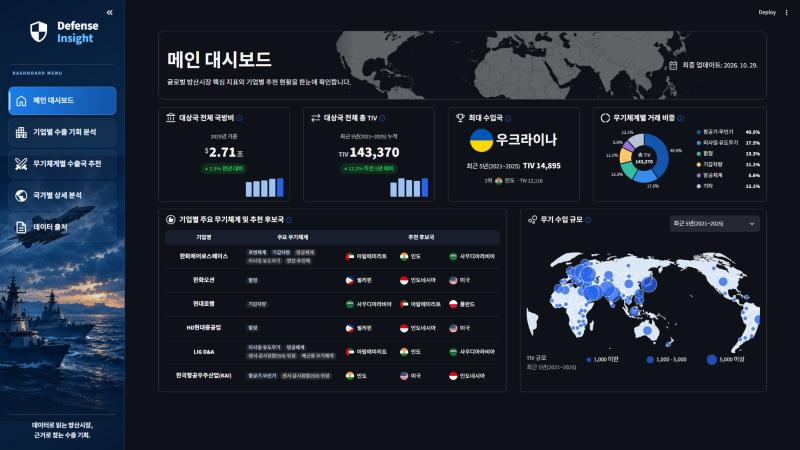
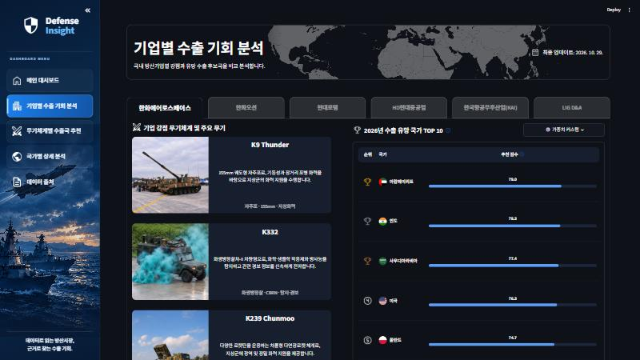
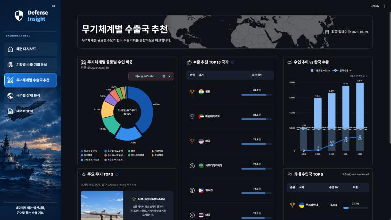
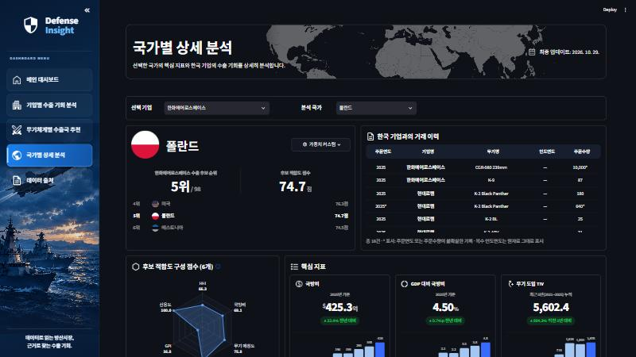
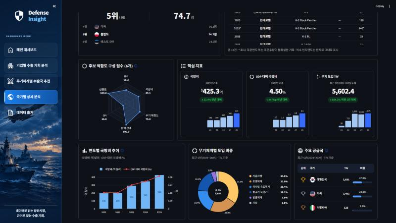
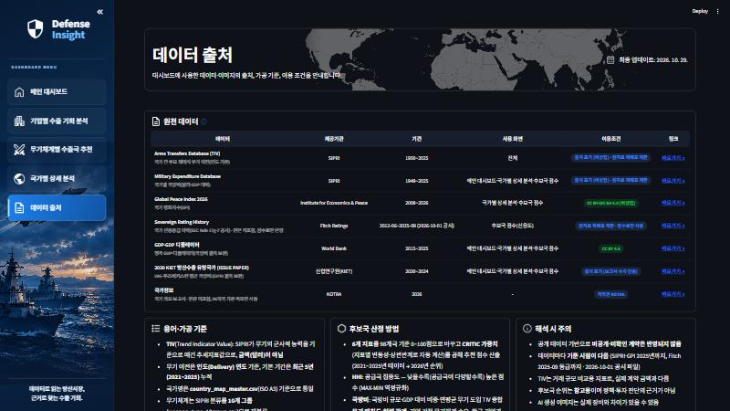

# Defense Insight
### 공개 방산거래 데이터 기반 기업·무기체계별 수출 후보국 스크리닝 대시보드

> 6개 핵심 지표와 CRITIC 가중치로 **국내 6개 방산기업 × 98개국**의 2026년 수출 유망 국가를 도출하여,  
> 흩어진 공개 데이터를 찾고 비교하던 **시장조사 시간을 줄이는 것**을 목표로 합니다.

| 🔗 배포 | 📊 분석 대상 | 🗓 기간 | 🏢 기업 |
|---|---|---|---|
| [k-defense-dashboard.streamlit.app](https://k-defense-dashboard.streamlit.app/) | 98개국 | 2016\~2025 (점수 산정 2021\~2025) | 한화에어로스페이스 · 한화오션 · 현대로템 · HD현대중공업 · LIG D&A · KAI |

<br>

## 1. 배경과 문제

- 글로벌 국방비 증가로 K-방산 수출 기회가 커지고 있지만, 후보국을 고르려면 무기 거래·국방비·평화지수·신용등급 등 **여러 기관 자료를 따로 찾아 비교**해야 합니다.
- 기업마다 강점 무기체계가 달라 **같은 국가라도 기업별 적합도가 다릅니다.**
- 본 프로젝트는 이 과정을 하나의 대시보드로 묶어, 기업·무기체계·국가 단위로 후보국을 빠르게 걸러낼 수 있게 합니다.

<br>

## 2. 대시보드 구성

<!-- TODO: 화면별 캡처 (images/readme/*.png) -->

| 화면 | 이런 질문에 답합니다 | 주요 내용 |
|---|---|---|
| **메인 대시보드** | 세계 무기 시장은 어떻게 움직이나? | 거래·국방비 KPI, 무기체계별 거래 비중, 기업별 추천 후보국 1\~3위 |
| **기업별 수출 기회 분석** | 우리 기업은 어디로 수출하면 좋을까? | 강점 무기체계·주요 무기, 2026년 수출 유망 국가 TOP 10, 가중치 커스텀 |
| **무기체계별 수출국 추천** | 이 무기체계는 어느 나라가 많이 사나? | 글로벌 수입 비중·추이, 최대 수입국 TOP 5, 수출 추천 TOP 10, 주요 무기 TOP 3 |
| **국가별 상세 분석** | 이 나라는 왜 이 순위인가? | 수출 후보 순위·적합도 점수, 6개 지표 레이더, 핵심 지표 5년 추이, 주요 공급국, 한국 기업 거래 이력 |
| **데이터 출처** | 데이터는 믿을 만한가? | 원천 데이터·가공 기준·이용 조건, 이미지 출처 |

화면 간 연결: 기업별 TOP 10에서 국가를 누르면 국가별 상세 분석으로 바로 이동하며, 가중치 설정은 화면 사이에 유지됩니다.

<br>

## 3. 분석 방법

### 3-1. 6개 지표

| 지표 | 의미 | 원천 |
|---|---|---|
| HHI | 공급국 집중도 — 낮을수록(공급국이 다양할수록) 높은 점수 (MAX-MIN 역정규화) | SIPRI Arms Transfers |
| 국방비 | 국방비 규모·GDP 대비 비중·연간 도입 TIV 총합 | SIPRI Milex, World Bank |
| 무기 매칭도 | 기업과의 기존 방산 거래 이력 및 기업 강점 무기체계의 국가별 수요 (무기체계별 점수에서는 '무기 수요') | SIPRI Arms Transfers |
| 협력 관계 | 한국과의 기존 방산 거래 이력 | SIPRI Arms Transfers |
| GPI | 평화지수 — 안보 위협이 클수록(GPI가 높을수록) 무기 수요가 커 높은 점수 | Global Peace Index |
| 신용도 | 국가 신용등급을 0\~100점(9단계)으로 변환 | Fitch Ratings |

지표별 선정 근거 문헌은 [11. 참고문헌](#11-참고문헌)을 참고하세요.

### 3-2. 점수 계산

1. 2021\~2025년 데이터로 지표를 산출하고 98개국 기준 **0\~100점으로 정규화** (치우친 분포는 로그 변환 후 정규화)
2. **CRITIC 가중치** = 표준편차 × Σ(1 − 상관계수) → 정보량이 많고 다른 지표와 겹치지 않는 지표에 더 큰 비중
3. 추천 점수 = Σ(지표 점수 × 가중치) → 2026년 순위
4. 대시보드 '가중치 커스텀'에서 사용자가 비중을 바꾸면 같은 지표 점수로 즉시 재계산

### 3-3. 데이터 처리 흐름

```text
data/raw (원천)  ──▶  src/preprocessing  ──▶  data/processed  ──▶  src/dashboard_score  ──▶  pages (대시보드)
SIPRI·GPI·Fitch       정제·국가 매핑·            final_score.csv 등      CRITIC 점수·순위
World Bank·KOTRA      TIV 연도별 분배
```

- 국가명은 `data/mapping/country_map_master.csv`(ISO A3) 기준으로 통일
- 무기 이전은 인도(Delivery) 연도 기준, 여러 해에 걸친 TIV는 연도별 균등 분배
- 무기체계는 SIPRI 206개 유형을 10개 그룹으로 재분류
- 전처리 단계별 행 수·결측 처리 내역은 `reports/`의 전처리 로그 참고 `TODO: 파일명`

<br>

## 4. 주요 결과

- **수요는 3개 무기체계에 집중** — 98개국의 최근 5년(2021\~2025) 무기 도입 TIV는 143,370이며, 항공기·무인기(40.5%), 미사일·유도무기, 함정 3개 체계가 71.3%를 차지합니다. 최대 수입국은 우크라이나(TIV 14,895)입니다.
- **기업 강점에 따라 유망국이 갈림** — 지상·방공 기업(한화에어로스페이스·현대로템·LIG D&A)은 아랍에미리트·사우디아라비아·인도·폴란드, 조선 기업(한화오션·HD현대중공업)은 필리핀·인도네시아, KAI는 인도·미국·인도네시아가 2026년 상위 후보국입니다.
- **추천 근거를 지표로 확인** — 한화에어로스페이스 기준 1위는 아랍에미리트(79.0점)이며, 폴란드(5위·74.7점)는 협력 관계·신용도는 만점이지만 GPI 점수(16.8)가 낮아 5위에 그칩니다.
- **한국 수출과 글로벌 수요 비교** — 미사일·유도무기는 2025년 글로벌 수입 TIV 5,876 대비 한국 수출 TIV 285로, 수요 대비 진입 여지를 같은 기준으로 확인할 수 있습니다.

> 추천 순위는 2021\~2025년 공개 데이터 기반의 참고 결과이며, 실제 수주·계약을 예측한 확정치가 아닙니다.

| 메인 대시보드 | 기업별 수출 기회 분석 |
|---|---|
|  |  |
| **무기체계별 수출국 추천** (미사일·유도무기) | **국가별 상세 분석** (한화에어로스페이스 × 폴란드) |
|  |  |
| **국가별 상세 분석 — 구성 점수·핵심 지표** | **데이터 출처** |
|  |  |

<br>

## 5. 실행 방법

```bash
# Python 3.11 기준
git clone https://github.com/yuwl1/k-defense-dashboard-public.git
cd k-defense-dashboard-public

py -3.11 -m venv .venv
.venv\Scripts\activate          # macOS/Linux: source .venv/bin/activate
pip install -r requirements.txt

streamlit run app.py            # https://k-defense-dashboard.streamlit.app/
```

- 대시보드는 `data/processed/`의 가공 데이터만으로 실행됩니다.
- 전처리를 다시 하려면 각 제공처에서 원천 데이터를 내려받아 `data/raw/`에 넣은 뒤 `src/preprocessing/` 스크립트를 실행합니다.

<br>

## 6. 데이터 출처와 공개 범위

| 데이터 | 제공 | 기간 | 저장소 포함 |
|---|---|---|---|
| Arms Transfers Database | SIPRI | 1950\~2025 | 가공·집계 결과만 |
| Military Expenditure Database | SIPRI | 1949\~2025 | 가공 결과만 |
| Global Peace Index 2026 | Institute for Economics & Peace | 2008\~2026 | 가공 결과만 (CC BY-NC-SA 4.0) |
| Sovereign Rating History | Fitch Ratings | 2012-06\~2025-09 | 가공 결과만(0\~100점 변환값)  |
| GDP·GDP 디플레이터 | World Bank | 2015\~2025 | 국방비 보완 결과만 |
| 2030 방산수출 유망국가 | 산업연구원(KIET) | 2020\~2024 | 인용 수치만 |
| 국가정보 | KOTRA | 2026 | 가공 결과만(98개국 목록) |

라이선스·이용 조건 전문: [THIRD_PARTY_NOTICES.md](THIRD_PARTY_NOTICES.md) · 이미지 출처: `images/**/credits.csv` (대시보드 '데이터 출처' 화면에서도 확인)

<br>

## 7. 한계와 유의사항

- 공개 데이터 기반으로 **비공개·미확인 계약은 반영되지 않습니다.**
- TIV는 SIPRI의 군사적 가치 지표로 **실제 계약 금액(달러)이 아닙니다.**
- 추천 순위는 **참고용**이며 정책·투자 판단의 근거가 아닙니다.
- 기업 로고는 상표권 보호를 위해 사용하지 않았으며, 기업명은 분석 대상을 구분하는 용도로만 표기합니다.

<br>

## 8. 기술 스택

| 구분 | 사용 |
|---|---|
| 언어 | Python 3.11 |
| 데이터 처리 | Pandas, NumPy, openpyxl |
| 시각화·대시보드 | Streamlit, Plotly |
| 분석 | CRITIC 가중치, Spearman·VIF 다중공선성 검토 등 (`src/analysis/`) |
| 협업 | Git / GitHub |

<br>

## 9. 프로젝트 구조

```text
k-defense-dashboard-public/
├── app.py                  # Streamlit 실행 파일 (메뉴·페이지 연결)
├── pages/
│   ├── 01_main.py          # 메인 대시보드
│   ├── 02_company.py       # 기업별 수출 기회 분석
│   ├── 03_weapon.py        # 무기체계별 수출국 추천
│   ├── 04_country.py       # 국가별 상세 분석
│   └── 05_sources.py       # 데이터 출처
├── components/             # 공통 화면 요소, 점수 연결, 가중치 커스텀
├── src/
│   ├── preprocessing/      # 원천 데이터 전처리
│   ├── dashboard_score/    # 추천 점수 계산 (기업별·무기체계별)
│   └── analysis/           # 통계 검증
├── data/
│   ├── processed/          # 대시보드용 가공 데이터
│   ├── mapping/            # 국가 매핑(ISO A3)
│   ├── analysis/           # 검증용 데이터
│   ├── sources/            # 데이터 출처 목록 (data_sources.csv)
│   └── raw/                # 원천 데이터 (저장소 제외)
├── images/                 # 아이콘·국기·무기 이미지 (폴더별 credits.csv)
├── reports/                # 보고서·발표 자료
├── THIRD_PARTY_NOTICES.md
├── LICENSE
└── requirements.txt
```

<br>

## 10. Team 방방(防防)곡곡

방위·방산을 뜻하는 '防'과 '방방곡곡'을 합쳐, K-방산의 수출 기회를 전 세계 방방곡곡에서 찾는다는 의미입니다.

| 구분 | 이름 | 역할 | 담당 업무 |
|---|---|---|---|
| 팀장 | 최진영 | DA | SIPRI & 무기체계 기업 수기 매핑표 구축, World Bank 지표 데이터 정제 및 분석 |
| 팀원 | 박태엽 | DA | SIPRI & 무기체계 기업 수기 매핑표 구축, World Bank 지표 데이터 정제 및 분석 |
| 팀원 | 임철홍 | DA | SIPRI & 무기체계 기업 수기 매핑표 구축, World Bank 지표 데이터 정제 및 분석 |
| 팀원 | 송재근 | AA | Streamlit 대시보드 기획 및 가중합 스코어링 로직 연동 |
| 팀원 | 안지영 | AA | Streamlit 대시보드 기획 및 가중합 스코어링 로직 연동 |
| 팀원 | 유지원 | TA | 개발 환경 표준화 협업, Git, Streamlit 환경 구축 및 관리/배포 |

> DA: Data Architect · AA: Application Architect · TA: Technical Architect

<br>

## 11. 참고문헌

### 11-1. 지표 선정 근거

| 지표 | 근거 문헌 | 반영 근거 |
|---|---|---|
| HHI | Johnson, R. A. I. (2020). Decision-Making in the Arms of a Dependent Relationship: Explaining Shifts in Importer Acquisition Patterns of Major Weapon Systems, 1955–2007. *Defence and Peace Economics*, 31(7), 851–868. [doi](https://doi.org/10.1080/10242694.2019.1618651) | 특정 공급국 의존도가 높을수록 공급국을 바꾸지 않음 → 공급국 집중도를 신규 공급국(한국) 진입 가능성 지표로 사용 |
| 국방비 | Tian, N., Ali, H., & Guiberteau Ricard, J. (2025). Determinants of the global arms imports: a revisit. *Defence and Peace Economics*. [doi](https://doi.org/10.1080/10242694.2025.2605954) | 143개국 1988\~2023년 분석에서 군사비가 무기 수입과 일관된 (+) 관계 → 국방비 규모·부담·증가 추세 반영 |
| 무기 매칭도 | Park, S., & Thakkar, C. (2025). Filling the weapons procurement gap in the Indo-Pacific: South Korean arms export to Indonesia and India. *Contemporary Security Policy*, 46(3), 613–640. [doi](https://doi.org/10.1080/13523260.2024.2441065) | 수출 성공은 성능보다 수입국 요구와의 부합도에 좌우 → 기업 강점 무기체계와 국가 수요의 매칭 반영 |
| 협력 관계 | Thurner, P. W., Schmid, C. S., Cranmer, S. J., & Kauermann, G. (2019). Network Interdependencies and the Evolution of the International Arms Trade. *Journal of Conflict Resolution*, 63(7), 1736–1764. [doi](https://doi.org/10.1177/0022002718801965) | 과거 거래(SIPRI TIV)가 이후 거래에 지속적 (+) 영향 → 한국과의 기존 방산 거래 이력 반영 |
| GPI | Tian et al. (2025), 위 문헌<br>Jang, Y., & Yang, J.-S. (2023). The Dynamics of the Global Arms Trade Network: States' Stability and Instability. *Defence and Peace Economics*, 34(7), 914–930. [doi](https://doi.org/10.1080/10242694.2022.2091610) | 분쟁·안보 위협과 대외적 불안정이 무기 수입 수요를 높임 → GPI를 안보 불안정의 대리지표로 사용 |
| 신용도 | 박근서 (2014). 방산수출 국제대금결제와 방산수출금융에 관한 고찰. 『무역보험연구』, 15(3), 139–165. [earticle](https://www.earticle.net/Article/A240129) | 구매국 정부의 신용도가 낮으면 대금 지급 위험 발생 → 국가 신용위험을 별도 지표로 반영 |

### 11-2. 방법론·참고 자료

- **CRITIC 가중치**: Diakoulaki, D., Mavrotas, G., & Papayannakis, L. (1995). Determining objective weights in multiple criteria problems: The CRITIC method. *Computers & Operations Research*, 22(7), 763–770.
- **산업연구원 보고서**: 심순형·민현기·김미정·박혜지 (2026. 3. 26.). 2030 KIET 방산수출 유망국가 (ISSUE PAPER 2026-01). 산업연구원. ISBN 979-11-94827-94-8. — UAE·우즈베키스탄 국방비 보완 및 유망국 비교에 참고 (무단 복제·전재 금지로 원문 미포함)
- **GPI 방법론**: Institute for Economics & Peace. [Understanding the GPI Methodology](https://www.visionofhumanity.org/understanding-the-global-peace-index-methodology/)
- **참고(학회 발표)**: Blomberg, S. B., & Tocoian, O. (2013). Terrorism and Arms Trade. AEA 2014 Annual Meeting. — GPI 보조 자료

<br>

## License

- 코드: [MIT License](LICENSE)
- 데이터·이미지: 각 제공처 이용 조건을 따르며 비상업적 교육 목적으로만 사용합니다. ([THIRD_PARTY_NOTICES.md](THIRD_PARTY_NOTICES.md))

## Feedback

문의·제안은 GitHub Issues로 남겨 주세요. [GitHub Issues 바로가기](https://github.com/yuwl1/k-defense-dashboard-public/issues)
